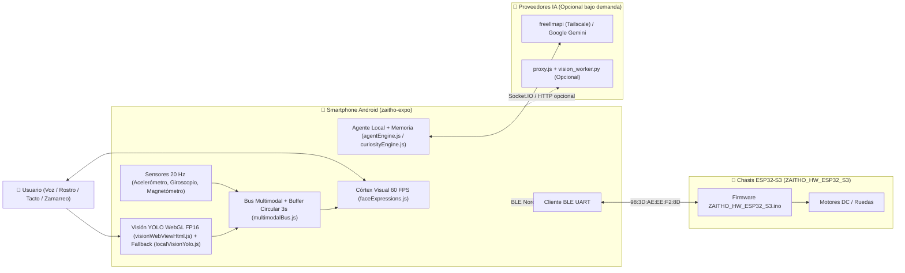

# 🤖 Zaitho Robot (VALHO)

Robot compañero autónomo de escritorio construido reutilizando un **smartphone Android** como cerebro principal (pantalla expresiva, cámara, micrófono, IMU y conectividad IA) acoplado vía **Bluetooth Low Energy (BLE)** a un chasis con **ESP32-S3**.

Inspirado en la expresividad de *Anki Vector*, Zaitho combina **visión por computadora en tiempo real (YOLO)**, **reconocimiento de voz en español**, **bus de eventos multimodal con buffer circular de 3 segundos**, **aprendizaje físico/topológico** e integración con **LLMs (`freellmapi` vía Tailscale y Google Gemini)**.

---

## 🧭 Arquitectura General



La aplicación móvil está diseñada para operar **directamente desde el celular** (sin requerir un PC encendido), conectándose directamente al chasis por BLE y consultando modelos de IA únicamente cuando se requiere razonamiento complejo o análisis de imagen detallado.

---

## 📁 Estructura del Repositorio

```text
VALHO/
├── zaitho-expo/                     # Aplicación móvil React Native / Expo SDK 58
│   ├── App.js                       # Orquestador principal (UI, BLE, Voz, IA, Sensores, Modos)
│   ├── visionWebViewHtml.js         # Motor YOLO (COCO-SSD) en vivo sobre WebGL FP16 (WebView)
│   ├── localVisionYolo.js           # Detector local puro JS (jpeg-js + clustering YCbCr)
│   ├── multimodalBus.js             # Bus de eventos, Buffer Circular 3s y 3 mecanismos de aprendizaje
│   ├── curiosityEngine.js           # Máquina de estados de curiosidad y caché de novedad
│   ├── faceExpressions.js           # Motor de expresiones faciales animadas (60 FPS)
│   ├── agentEngine.js               # Herramientas locales (cálculo, memoria, clima Open-Meteo)
│   ├── android/                     # Proyecto nativo Android (Gradle)
│   └── package.json
│
├── ZAITHO_HW_ESP32_S3/              # Firmware ESP32-S3 y utilidades de servidor opcional
│   ├── ZAITHO_HW_ESP32_S3.ino       # Firmware del chasis con servidor BLE UART Nordic
│   ├── config.h                     # Pines y configuración de hardware
│   ├── proxy.js                     # Servidor Node.js + Socket.IO opcional (memoria/aprendizaje/visión)
│   ├── vision_worker.py             # Worker Python opcional (YOLOv8n + OpenCV Haar/CLAHE)
│   ├── zaitho_brain_ui.html         # Interfaz web auxiliar
│   └── studio.html                  # Consola de pruebas
│
├── AUTO_BLUETOOHT_ESP32_DIGITAL_MODE/   # Pruebas previas de control digital Bluetooth
├── AUTO_BLUETOOHT_ESP32_JOYSTICK_MODE/  # Pruebas previas de control por joystick
└── AUTO_TEST_ESP32_DRIVER/              # Pruebas unitarias de driver de motores
```

---

## ✨ Funcionalidades Principales

### 1. Expresividad y Física Interactiva (`faceExpressions.js` + IMU)
- **Ojos animados a 60 FPS** (`happy`, `curious`, `love`, `scared`, `dizzy`, `angry`, `yawning`, `excited`, `aha_eureka`, `searching_radar`, etc.) con parpadeo orgánico, mejillas al acariciar y partículas animadas.
- **Reacción realista al zamarreo**: al sacudir fuertemente el robot (`deltaG > 0.78`), pone ojos mareados y grita (`"¡Aaaaaaaaaaaahhh!"`) mientras dura el movimiento; al soltarlo, entra en estado `angry` y ejecuta un berrinche (`TANTRUM`) con las ruedas. No se enoja por simples inclinaciones al rodar.

### 2. Visión por Computadora en Tiempo Real (Prioridad YOLO)
- **Streaming en vivo WebGL FP16** (`visionWebViewHtml.js`): ejecuta **COCO-SSD (YOLO)** sobre `getUserMedia` en un canvas reducido (`160x120`) a ~2.8 FPS para evitar sobrecalentamiento del teléfono, sin destellos de cámara (`animateShutter={false}`, `flash="off"`).
- **Seguidor de Rostro**: sigue tu rostro moviendo los ojos (`gazeX`, `gazeY`) suavemente dentro del encuadre y gira las ruedas del chasis cuando te acercas a los bordes o sales de cámara.
- **Modo Explorador con Evasión Visual**: avanza continuamente enviando pulsos seguros de movimiento, esquiva obstáculos detectados al frente/cerca y registra objetos nuevos localmente sin saturar llamadas a internet.
- **Análisis de precisión bajo demanda**: las imágenes solo se envían al LLM (`freellmapi` o Gemini) cuando el usuario pide explícitamente detalle (*"analiza en detalle"*, *"qué marca es"*, *"lee esto"*).

### 3. Bus Multimodal, Buffer Circular y Aprendizaje Continuo (`multimodalBus.js`)
- **Hilos desacoplados**: Propiocepción (20 Hz), Clasificación acústica + VAD (bloques de 1s con modo ahorro en silencio), Visión periférica y Córtex visual (60 FPS por interrupciones).
- **Buffer Circular en RAM (3s)**: mantiene en memoria los últimos 3 segundos de contexto multimodal y se congela únicamente ante triggers biológicos (`audio:bang`, `proprio:lifted`).
- **3 Mecanismos de Aprendizaje**:
  - **Calibración Motora Autónoma (`MotorCalibrationTracker`)**: mide con el giroscopio el ángulo real de giro respecto al solicitado y ajusta `leftGain` / `rightGain` para compensar motores desgastados.
  - **Condicionamiento Clásico Acústico (`ClassicalConditioningMemory`)**: refuerza la asociación música → baile cuando detecta rostro/recompensa positiva.
  - **Mapas Topológicos (`TopologicalMemoryMap`)**: combina magnetómetro + odometría para recordar en qué rumbo magnético se encuentran objetos o el usuario.

### 4. Conectividad IA y Voz en Español
- **Proveedores intercambiables**: `freellmapi` (con resolución paralela entre endpoint HTTPS Tailscale y IP Tailscale) y **Google Gemini** (`gemini-2.5-flash` / `gemini-2.5-pro`).
- **Herramientas locales sin internet** (`agentEngine.js`): consultas de estado/hora/batería, matemáticas, memoria persistente (`AsyncStorage` / `FileSystem`) y clima en vivo vía Open-Meteo.

---

## 🛠️ Protocolo BLE UART (Celular ↔ ESP32-S3)

- **Dispositivo BLE**: `ZAITHO_ROBOT` (`98:3D:AE:EE:F2:8D`)
- **Service UUID**: `6e400001-b5a3-f393-e0a9-e50e24dcca9e`
- **RX UUID**: `6e400002-b5a3-f393-e0a9-e50e24dcca9e`
- **TX UUID**: `6e400003-b5a3-f393-e0a9-e50e24dcca9e`

| Comando | Descripción |
| :--- | :--- |
| `F:dur:vel` / `B:dur:vel` | Avanzar / Retroceder durante `dur` ms a velocidad `vel` (con auto-freno `S` de seguridad) |
| `L:dur:vel` / `R:dur:vel` | Girar a izquierda / derecha |
| `S` | Parada de emergencia inmediata |
| `DANCE` | Coreografía rítmica de baile |
| `TANTRUM:L` / `TANTRUM:R` | Berrinche con sacudida de ruedas |
| `ALIVE` | Micro-movimiento autónomo de curiosidad |
| `PET:L` / `PET:R` | Reacción física al acariciar el ojo izquierdo/derecho |

---

## 🚀 Instalación y Uso

### 1. Desarrollo rápido en vivo (Expo Go)
> Nota: En **Expo Go** genérico los módulos nativos `react-native-ble-plx` y `expo-speech-recognition` operan en modo seguro simulado; el BLE real y el micrófono continuo se activan al compilar la APK.

```bash
cd zaitho-expo
npm install
npx expo start --lan --port 8085
```
Abre **Expo Go** en el teléfono y conéctate a `exp://<TU_IP_LAN>:8085`.

### 2. Compilar APK Release Android (vía Docker)

```bash
docker run --rm \
  -v "$(pwd)/zaitho-expo:/project" \
  -w /project/android \
  reactnativecommunity/react-native-android \
  ./gradlew assembleRelease --no-daemon
```

Instalar la APK resultante en el teléfono por USB (`adb`):

```bash
adb install -r zaitho-expo/android/app/build/outputs/apk/release/app-release.apk
```

### 3. Firmware ESP32-S3
Abre `ZAITHO_HW_ESP32_S3/ZAITHO_HW_ESP32_S3.ino` en **Arduino IDE** o **PlatformIO**, ajusta los pines en `ZAITHO_HW_ESP32_S3/config.h` según tu puente H / chasis, y flashea la placa ESP32-S3.

### 4. Servidor Auxiliar Opcional (`ZAITHO_HW_ESP32_S3/proxy.js`)
Si deseas respaldar aprendizaje o usar YOLOv8n + OpenCV en un servidor externo:

```bash
cd ZAITHO_HW_ESP32_S3
npm install
node proxy.js
```

---

## 📄 Licencia

Consulta el archivo [LICENSE](zaitho-expo/LICENSE) para más información.
